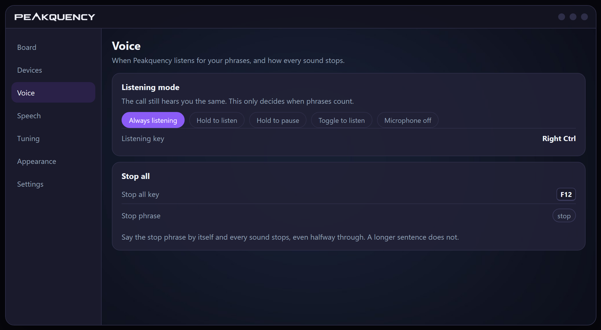
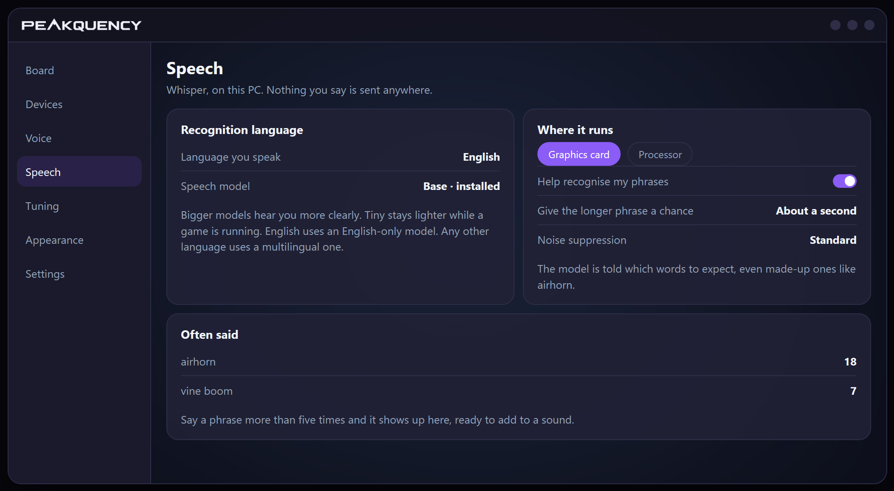
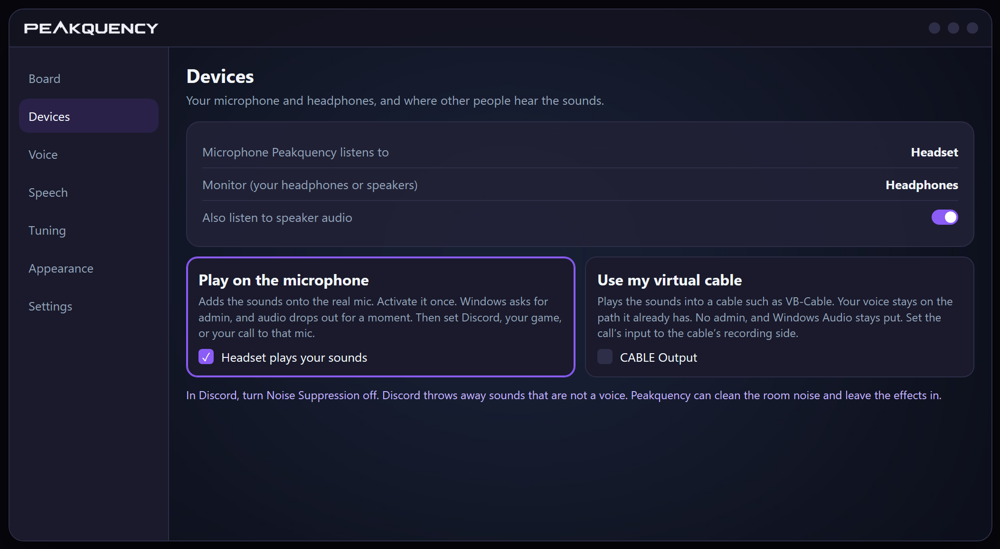
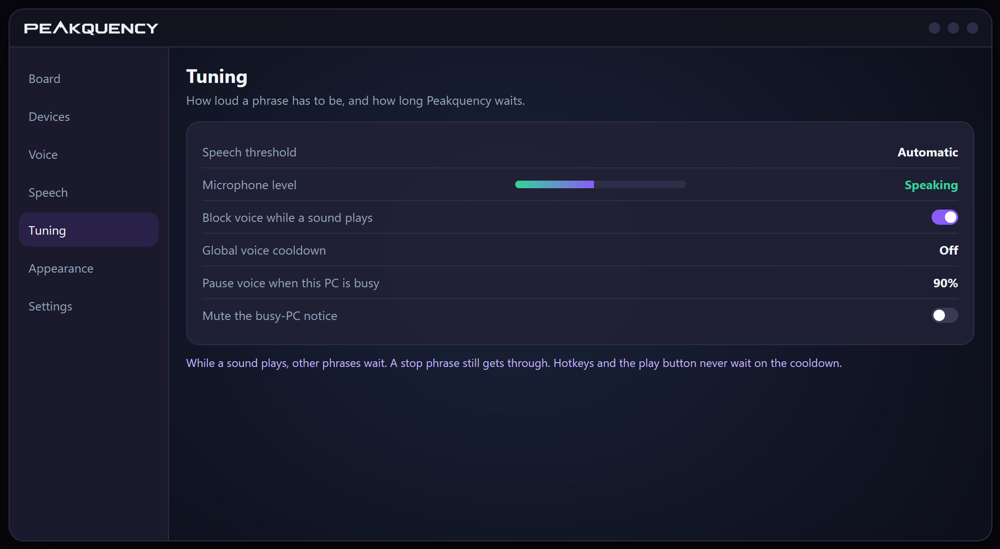
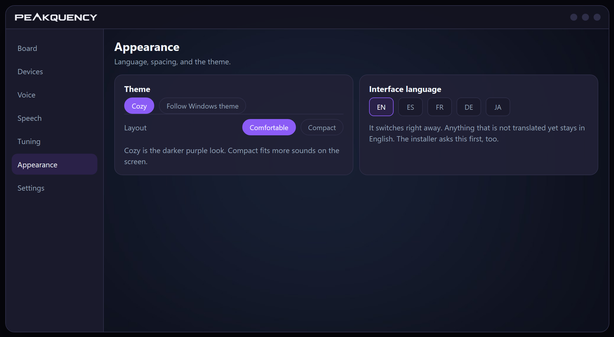
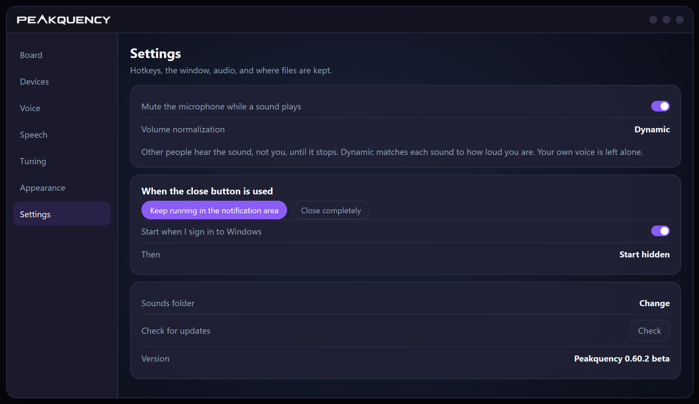

<p align="center">
  
</p>

<p align="center">
  <strong>Say it, press it, or click it.</strong><br>
  The people in your Discord call, game, or meeting hear the sound too. You hear it in your headphones at the same time.
</p>

<p align="center">
  <a href="https://github.com/Leonevets/Peakquency-releases/releases/download/v0.60.2/Peakquency-Setup-0.60.2.exe"></a>
  &nbsp;
  <a href="https://github.com/Leonevets/Peakquency-releases/releases/download/v0.60.2/Peakquency-0.60.2-win-x64-portable.zip"></a>
  &nbsp;
  <a href="https://github.com/Leonevets/Peakquency-releases/releases"></a>
</p>

<p align="center">
  Windows 10 or 11 &nbsp;·&nbsp; English, Spanish, French, German, Japanese &nbsp;·&nbsp; Speech stays on your PC
</p>

<p align="center">
  
</p>

The pictures below are drawn examples of the real pages, so you can see the layout without anyone's personal board.

## The board

<p align="center">
  
</p>

Each row is a sound. **Play** sends it to you and to the call. **Preview** is only for you. The master volume scales every sound. Your voice keeps its own level.

- **Categories** group the board. A sound can sit in more than one. Drag a category to reorder it.
- **Search** filters the list. **Sort** can follow name, date, length, voice, hotkey, or an order you save.
- **Presets** are whole boards, sounds included. Save the one you are on, or switch to another. Sounds that are not in the one you load go to the Recycle Bin.
- **Save board** writes a file you can take to another Peakquency, with the audio or with just the layout. **Load board** can add those sounds beside yours, or replace the board.
- Drop in sounds, a video, or a zip. A video comes in as the audio tracks you pick. WAV, MP3, FLAC, M4A, AAC, WMA, AIFF, Ogg Vorbis, Opus, AC-3, and DTS play as they are. Anything else is converted to FLAC after a warning.
- Removing a sound can delete the file or **archive** it, so you can put it back later.

## Phrases

<p align="center">
  
</p>

A phrase on a sound plays it. A blocking phrase keeps that one sound quiet. The stop phrase, said by itself, stops every sound and does not wait. The guide sits beside the board, so you can try a phrase while you read it.

- The same words can live in only one place. Capitals do not count, so Oh no and oh no are the same. Not correct and correct are different.
- Spaces inside a phrase do not matter. airhorn and air horn match. Accents come off. The word has to be whole, so no does not play inside nope or know.
- Punctuation is ignored, in the phrase and in what you say. airhorn! still plays when you say airhorn. An apostrophe drops out, so don't matches dont.
- Share a word and the longer phrase plays. A short phrase that starts a longer one waits, about a second by default, before the short sound plays.
- While a sound is playing, later phrases are ignored. A stop phrase still gets through. That is Block voice while a sound plays, on Tuning.
- Japanese, Chinese, Thai, and similar writing are not split into words. A shorter phrase can match inside a longer run of characters. The longer one still wins.

## Voice

<p align="center">
  
</p>

Voice has to be on, and the sound's own Voice switch too. The listening mode does not change what the call hears. It only decides when your phrases count.

| Mode | What it does |
|---|---|
| Always listening | Hears you whenever Voice is on |
| Hold to listen | Hears only while the key is held |
| Hold to pause | Hears until you hold the key |
| Toggle to listen | Each press starts or stops listening |
| Microphone off | Leaves the mic out |

The listening key can be any key, including a bare modifier such as Right Ctrl. **Stop all** has its own key, and its own phrase. Say that phrase by itself and everything stops, even halfway through. don't stop and stop it keep going, so a sound can use those words.

## Speech

<p align="center">
  
</p>

Peakquency uses Whisper on this PC. Nothing you say is sent anywhere. Every speech model runs offline.

The first time Voice turns on, it offers to download a model. Bigger models hear you more clearly and use more of the computer. Tiny is lighter while a game is running. English can use a smaller English-only model. Any other language, and Detect automatically, use a multilingual one.

**Help recognise my phrases** tells the model which words to expect, even made-up ones like airhorn. **Give the longer phrase a chance** is the wait before a short phrase plays. **Noise suppression** softens steady noise for voice commands, and for the mic your call is using. Standard is lighter. Strong takes more noise and keeps your voice bright. What you hear on speaker listening stays as it is. Peakquency only cleans its own copy of that audio.

**Often said** counts phrases you repeat. After five times, one can be added to a sound. Voice can run on the graphics card or the processor. The graphics card is faster and leaves the processor freer. A game can lose a few frames. The processor leaves the graphics card alone.

## So other people hear it

<p align="center">
  
</p>

Pick the microphone Peakquency listens to, and the headphones or speakers where you hear the sounds. Then choose how the call hears them.

**Play on the microphone** adds the sounds onto the real mic. Windows asks for administrator permission once, and audio drops out for a moment. Set Discord, your game, or your call to a mic you checked. More than one mic can play sounds at once.

**Use my virtual cable** plays the sounds into a cable such as VB-Cable. Your voice stays on the path it already has. No admin, and Windows Audio stays put. Set the call's input to the cable's recording side.

In Discord, turn Noise Suppression off, and Echo Cancellation too if you use Custom. Discord throws away sounds that are not a voice. Peakquency can clean the room noise and leave the effects in.

**Also listen to speaker audio** hears phrases from a playback device at the same time as the mic. Listening keys only affect the mic. A phrase from the speakers can start a sound, and a stop phrase can stop one.

## Shape the clip

<p align="center">
  
</p>

The editor trims the start and the end, cuts a piece out of the middle, and sets a fade in, a fade out, and a volume change. **Normalize** lifts the loudest part of what you kept to just under full level. Play is a preview, and only you hear it.

**Save as new sound** writes a new file and leaves the original alone. **Overwrite** replaces the file, and asks first, because that cannot be undone. The result is an ordinary 16-bit WAV. A sound can also set its own voice cooldown here, or follow the global wait.

## Tuning

<p align="center">
  
</p>

The speech threshold is how loud a phrase has to be. Automatic stays a little above the quiet of the room. Raise it if the room sets voice off. Lower it if your voice gets missed. The bar shows the mic and turns green while you talk.

**Block voice while a sound plays** ignores other phrases until the sound ends. A stop phrase still gets through. Turn it off and the next sound can start on top. A little extra ignore after the sound stops keeps a speaker tail from triggering another one.

The global voice cooldown is off until you set one. Hotkeys and the play button never wait. **Pause voice when this PC is busy** stops listening once the processor or graphics card it uses goes over the level you pick. It listens again when usage drops. The Voice switch stays on. The notice can be muted. Voice still pauses.

## Look, language, and the window

<p align="center">
  
</p>

<p align="center">
  
</p>

**Cozy** is the darker purple look. **Follow Windows theme** uses the colors Windows is using. Compact fits more sounds on the screen. The interface language switches right away. Anything that does not have a translation yet stays in English. The installer asks this first, and a first launch follows that choice. A language already saved is left alone.

**Mute the microphone while a sound plays** means other people hear the sound, not you, until it stops. Preview and the editor leave the mic alone. **Volume normalization** can follow how loud you are right now, or use one fixed level. Each sound's volume and the master still apply. Your voice in the mix is left alone.

Close can leave Peakquency running by the clock, so hotkeys and voice keep working, or it can quit. It can also start when you sign in, in the window or hidden. If noise suppression is on, quitting warns you, because the mic goes back to the raw feed.

Hotkeys work while another program is in front. A typing key needs a modifier, unless it is a function key, a numpad key, a media key, or a mouse button. Mouse 4, mouse 5, middle click, right click, and the scroll wheel work on their own. Two sounds cannot share one key. If a game is running as administrator, start Peakquency as administrator too, or its hotkeys go quiet while that game is in front.

## Where your files live

| | |
|---|---|
| `config.json` | devices, volumes, switches, hotkeys, and the sound list |
| `sounds\` | copies of the sound files. Your originals are never touched |
| `presets\` | named boards, audio included |
| `models\` | downloaded speech models |
| `logs\` | one log file per day |

That folder sits next to `Peakquency.exe` when the folder is writable, so a portable copy can live on a USB stick. An install under Program Files uses `%LOCALAPPDATA%\Peakquency` instead. Settings shows the folder and can move `sounds\` somewhere else. Uninstall does not delete a folder you moved.

Activating a microphone also writes a few machine files under `%ProgramData%\Peakquency`. Those are not your sounds or settings.

`--data-dir <path>`, or the `PEAKQUENCY_DATA` environment variable, points one copy at a different folder. Only one Peakquency runs at a time. A second launch brings the open window forward.

## Install and remove

`Peakquency-Setup-0.60.2.exe` installs to Program Files. The first question is the language. A silent install stays English unless it is started with a language, such as `/LANG=es`. The setup installs the .NET 8 Desktop Runtime when that is missing, and registers activation for sounds. The last page can launch Peakquency. Running it again updates the copy already in Program Files.

`Peakquency-0.60.2-win-x64-portable.zip` is a folder you can copy and run. It includes the .NET 8 runtime, and sounds and settings stay inside that folder.

Removing the program restores every microphone that was activated for sounds. If any microphone is activated, uninstall first warns that every audio device will disconnect for a moment. Cancel leaves Peakquency installed. Continue goes on to the normal remove confirmation, and Windows audio restarts after that. The same page offers to delete each account's Peakquency folder and `%ProgramData%\Peakquency`. That box starts checked. Uncheck it to keep those files. A sounds folder moved in Settings is not deleted. If restoring the microphones fails, the ProgramData folder is left in place.

Check for updates looks at the public releases. An installed copy closes and opens setup. A portable copy replaces itself and opens again. Sounds and settings stay.

## Build

From a copy of the source:

```powershell
dotnet build Peakquency.sln
dotnet run --project src\Peakquency
dotnet test Peakquency.sln
installer\package.ps1
```

`installer\package.ps1` writes `Peakquency-Setup-0.60.2.exe` and `Peakquency-0.60.2-win-x64-portable.zip` under `artifacts\`. Building it yourself needs the .NET 8 SDK.
