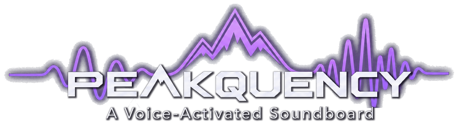
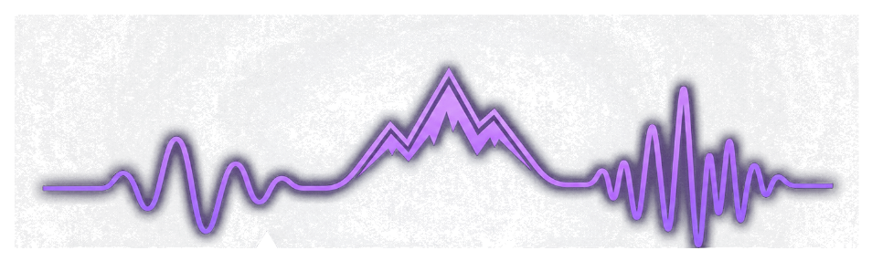
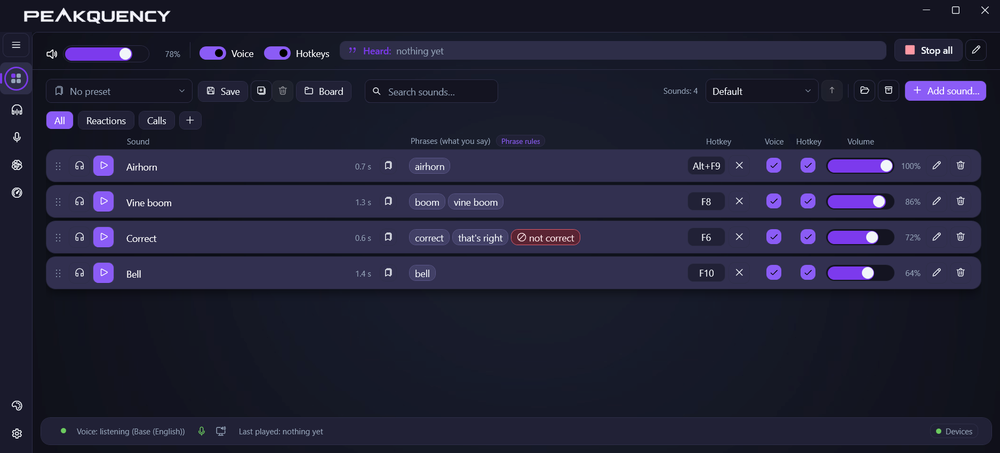
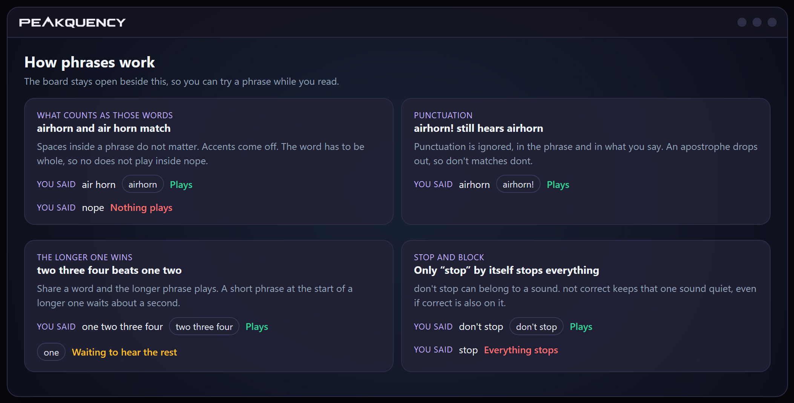
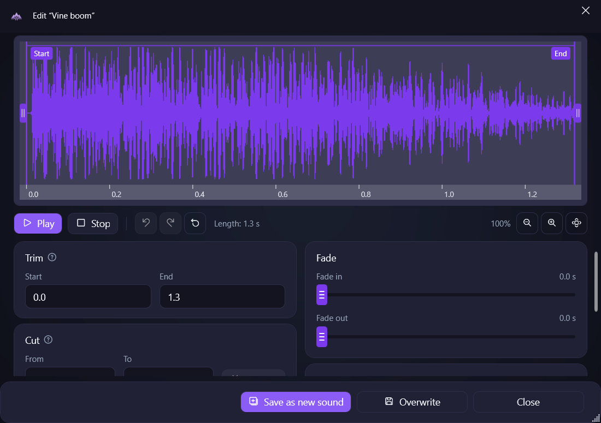

  

  <strong>🎤 Say it. &nbsp; ⌨️ Press it. &nbsp; 🖱️ Click it.</strong> 
  Your Discord call, game, or meeting hears the sound too. 
  So do you, right in your headphones.

  
  &nbsp;
  
  &nbsp;
  

<table>
  <tr>
    <td align="center" width="33%">🪟 <strong>Windows 10 or 11</strong></td>
    <td align="center" width="33%">🌍 <strong>English, Spanish, French, German, Japanese</strong></td>
    <td align="center" width="33%">🔒 <strong>Speech stays on your PC</strong></td>
  </tr>
</table>

  

<table>
  <tr>
    <td align="center" width="33%">
      <h3>🎤 Say it</h3>
      Give a sound a phrase. Say it, and it plays.
    </td>
    <td align="center" width="33%">
      <h3>⌨️ Press it</h3>
      A hotkey fires the sound whenever you want.
    </td>
    <td align="center" width="33%">
      <h3>🖱️ Click it</h3>
      Play sends it to the call. Preview is just for you.
    </td>
  </tr>
</table>

## 🎛️ The board

  

> [!TIP]
> Categories, search, and sort keep a big board from turning into a junk drawer. A blocking phrase, like `not correct` on Correct, tells that one sound to sit this one out.

## 🗣️ Say a phrase

  

> [!NOTE]
> The guide hangs out next to the board, so you can try a phrase while you read. Spaces inside a phrase don't matter. Punctuation doesn't either. The longer phrase wins, and only the stop phrase, all by itself, stops the show.

## ✂️ Shape the clip

  

> [!NOTE]
> Chop the start, chop the end, or cut a hole out of the middle. A fade eases it in or out. Play in here is a preview, so only you hear it. Save it as a new sound, or overwrite this one.

## 📦 The other good parts

<strong>🎧 Getting it onto the call</strong>

 

Play the sounds on your real microphone, or send them into a virtual cable such as VB-Cable. Then point Discord, your game, or your call at that input.

> [!WARNING]
> Turn Discord's noise suppression off, or it tosses anything that isn't a voice.

<strong>👂 Listening</strong>

 

Listen all the time, hold to listen, hold to pause, toggle it, or leave the microphone out of it. The call still hears you the same either way.

A stop key and a stop phrase end whatever is playing.

<strong>🧠 Speech stays on this PC</strong>

 

Whisper runs right here, on your graphics card or your processor. Nothing you say gets sent anywhere.

Bigger models catch more of what you said. Tiny is the light one when a game is already using the machine.

<strong>⏸️ While a sound is playing</strong>

 

Other phrases can wait their turn. A stop phrase still gets through. Hotkeys and the Play button never sit on a cooldown.

<strong>🎨 Your window</strong>

 

Cozy is the darker purple look, or you can follow Windows. Compact fits more sounds on the screen. Closing the window can leave Peakquency sitting by the clock. It can also start with Windows, in the window or tucked away.

<strong>🧳 Boards you can carry</strong>

 

A preset is the whole board, sounds included. Save one to a file and open it on another Peakquency, with the audio or with just the layout.

<strong>📁 Files</strong>

 

Sounds, presets, settings, and speech models live next to the program when that folder can be written to, and in `%LOCALAPPDATA%\Peakquency` once it's installed.

Drop in WAV, MP3, FLAC, M4A, AAC, WMA, AIFF, Ogg Vorbis, Opus, AC-3, or DTS. Got a video? Peakquency keeps the audio and leaves the picture behind.

<strong>💾 Install, and taking it back off</strong>

 

| | |
| --- | --- |
| 🪟 **Setup** | `Peakquency-Setup-0.60.2.exe` installs to Program Files and grabs the .NET 8 Desktop Runtime if it's missing. The first thing it asks is your language. |
| 📦 **Portable zip** | `Peakquency-0.60.2-win-x64-portable.zip` is a folder you can copy and run. The runtime is already in there. |

Taking it off puts every microphone that was switched on for sounds back the way it was. If one was switched on, uninstall warns you that audio drops out for a moment. It can also delete the Peakquency folders. A sounds folder you moved in Settings stays where you put it.

## Licenses

Only the notices these licenses say we have to keep.

### Opus, through Concentus

Copyright (c) by various holding parties, including (but not limited to): Skype Limited, Xiph.Org Foundation, CSIRO, Microsoft Corporation, Jean-Marc Valin, Gregory Maxwell, Mark Borgerding, Timothy B. Terriberry, Logan Stromberg. All rights are reserved by their respective holders.

Redistribution and use in source and binary forms, with or without modification, are permitted provided that the following conditions are met:

- Redistributions of source code must retain the above copyright notice, this list of conditions and the following disclaimer.
- Redistributions in binary form must reproduce the above copyright notice, this list of conditions and the following disclaimer in the documentation and/or other materials provided with the distribution.
- Neither the name of Internet Society, IETF or IETF Trust, nor the names of specific contributors, may be used to endorse or promote products derived from this software without specific prior written permission.

THIS SOFTWARE IS PROVIDED BY THE COPYRIGHT HOLDERS AND CONTRIBUTORS "AS IS" AND ANY EXPRESS OR IMPLIED WARRANTIES, INCLUDING, BUT NOT LIMITED TO, THE IMPLIED WARRANTIES OF MERCHANTABILITY AND FITNESS FOR A PARTICULAR PURPOSE ARE DISCLAIMED. IN NO EVENT SHALL THE COPYRIGHT HOLDER OR CONTRIBUTORS BE LIABLE FOR ANY DIRECT, INDIRECT, INCIDENTAL, SPECIAL, EXEMPLARY, OR CONSEQUENTIAL DAMAGES (INCLUDING, BUT NOT LIMITED TO, PROCUREMENT OF SUBSTITUTE GOODS OR SERVICES; LOSS OF USE, DATA, OR PROFITS; OR BUSINESS INTERRUPTION) HOWEVER CAUSED AND ON ANY THEORY OF LIABILITY, WHETHER IN CONTRACT, STRICT LIABILITY, OR TORT (INCLUDING NEGLIGENCE OR OTHERWISE) ARISING IN ANY WAY OUT OF THE USE OF THIS SOFTWARE, EVEN IF ADVISED OF THE POSSIBILITY OF SUCH DAMAGE.

Concentus redistributes an independently compiled Opus codec under these same terms.

### Apache License 2.0

sherpa-onnx, ONNX Runtime, and DPDFNet use the Apache License 2.0. That license says anyone who receives the software also receives a copy of it: http://www.apache.org/licenses/LICENSE-2.0

### MIT

The MIT license says its copyright line and permission notice stay with the software.

- Copyright (c) .NET Foundation and Contributors (.NET, Community Toolkit MVVM)
- Copyright 2020 Mark Heath (NAudio)
- Copyright (c) 2020 Andrew Ward (NVorbis)
- Copyright (c) 2024 sandrohanea (Whisper.net)
- Copyright (c) Georgi Gerganov (whisper.cpp)
- Copyright (c) 2021-2025 Leszek Pomianowski and WPF UI Contributors (WPF-UI)

GTCRN, Concentus.Oggfile, and the Whisper speech models are published under the MIT License.

Permission is hereby granted, free of charge, to any person obtaining a copy of this software and associated documentation files (the "Software"), to deal in the Software without restriction, including without limitation the rights to use, copy, modify, merge, publish, distribute, sublicense, and/or sell copies of the Software, and to permit persons to whom the Software is furnished to do so, subject to the following conditions:

The above copyright notice and this permission notice shall be included in all copies or substantial portions of the Software.

THE SOFTWARE IS PROVIDED "AS IS", WITHOUT WARRANTY OF ANY KIND, EXPRESS OR IMPLIED, INCLUDING BUT NOT LIMITED TO THE WARRANTIES OF MERCHANTABILITY, FITNESS FOR A PARTICULAR PURPOSE AND NONINFRINGEMENT. IN NO EVENT SHALL THE AUTHORS OR COPYRIGHT HOLDERS BE LIABLE FOR ANY CLAIM, DAMAGES OR OTHER LIABILITY, WHETHER IN AN ACTION OF CONTRACT, TORT OR OTHERWISE, ARISING FROM, OUT OF OR IN CONNECTION WITH THE SOFTWARE OR THE USE OR OTHER DEALINGS IN THE SOFTWARE.
